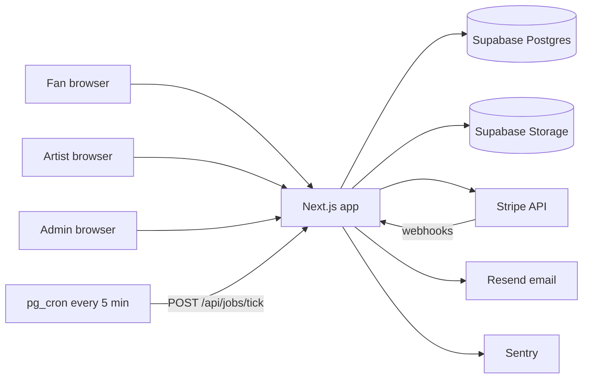
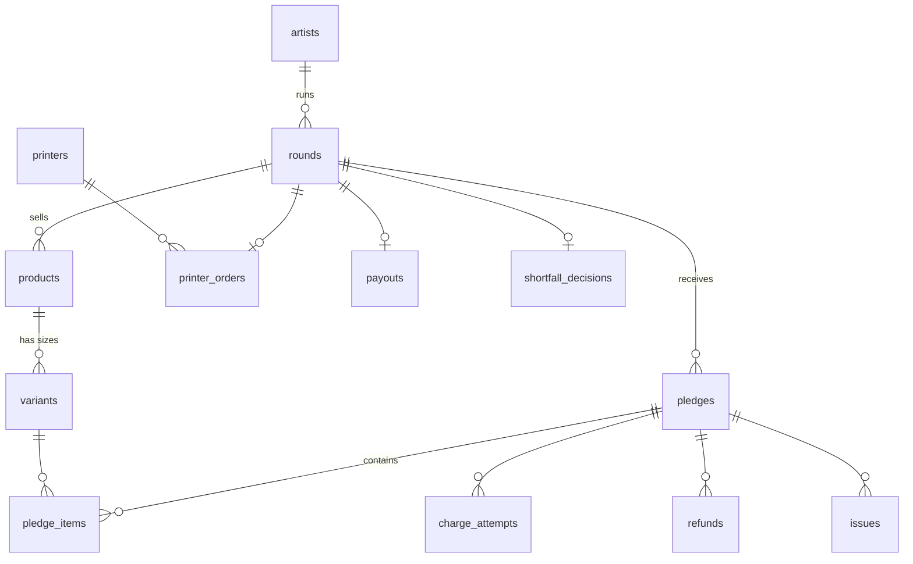
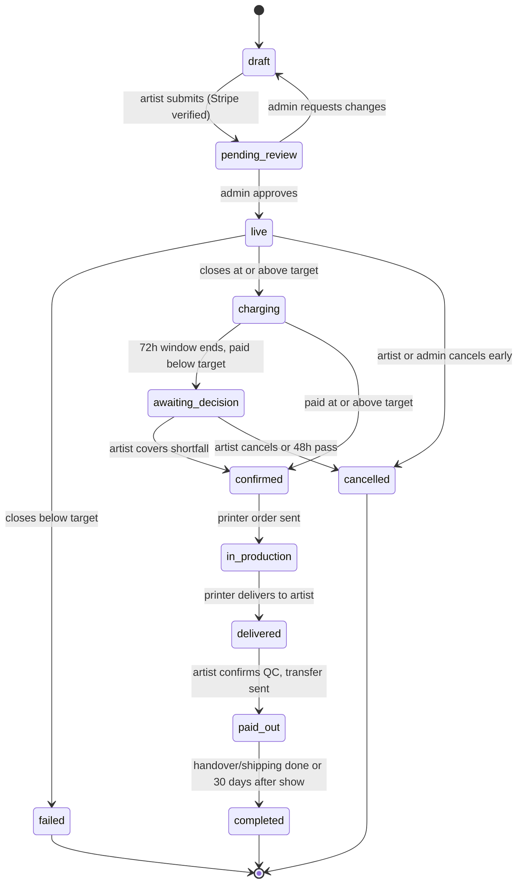
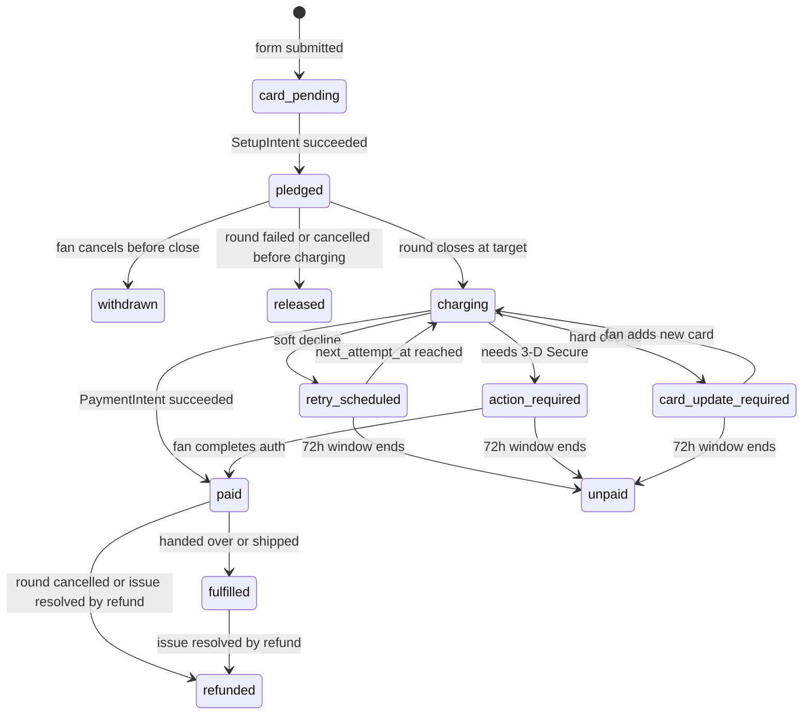

# Merch Round — Technical Plan

Status: draft v1 · Oct 2026
Scope: everything needed to go from the Lovable demo to a working product, built on free tiers until there is real traffic.

---

## 1. What we are building

Merch Round lets an artist run a short pre-order window (a **round**) for merch. The artist sets the number of orders that makes a print run worthwhile. Fans pledge by saving a card. If the round reaches its number, every fan is charged, the platform pays the printer, the merch is made, fans collect it at the show (or get it posted), and the artist is paid their share. If the round misses, nobody is charged and nothing is printed.

### 1.1 Actors

| Actor | What they do |
|---|---|
| Fan | Browses a round, picks size and quantity, saves a card, collects or receives merch |
| Artist | Verifies identity with Stripe, creates rounds, decides on shortfalls, confirms delivery, hands over merch at the show |
| Admin (us) | Reviews rounds, sends orders to printers, pays printer invoices, handles issues and refunds |
| Printer | Receives order and invoice request, produces and delivers merch (no login in v1) |
| Stripe | Saves cards, charges, refunds, verifies artists, pays artists out |

### 1.2 Core rules (product decisions baked into the code)

- **Fans pay nothing until the round succeeds.** Cards are saved with a Stripe SetupIntent, not held with an authorisation (authorisations expire after about 7 days, which is shorter than a round).
- **Rounds run 14 days by default.** The close date must be at least `lead time + 2 weeks` before the show. The create screen suggests the latest safe close date; the artist can pick an earlier one.
- **Target formula** (from the demo, kept as the default suggestion; the artist may raise it, never lower it below the printer minimum):
  `target = max(minRun, ceil(printerQuote × 1.3 / (price × 0.9)))`
  The 1.3 is a buffer so a few declined cards don't sink the round.
- **Platform fee is 10% of what fans pay.** Card fees come out of our 10%. Fans pay the listed price, nothing more.
- **Artist share** = `gross collected − platform fee − printer invoice − refunds issued after confirmation`.
- **Charging window**: when a round hits its number at close, cards are charged immediately. Soft declines are retried for up to 72 hours. Cards that need 3-D Secure get an email link.
- **Shortfall**: if, after the 72 hours, paid orders are below target, the artist has 48 hours to either cover the gap or cancel. No reply means cancel.
- **Cancel after charging** refunds everyone. Stripe keeps its processing fee; we absorb it.
- **Payout** happens after the artist confirms they received the goods and passed a quality check.

> Open product question: the diagram pays the artist on receipt, the demo says "after handover". This plan pays on receipt (step 7.6) because handover can be weeks later. Easy to change: it is one state transition.

---

## 2. Tech stack (all free tier)

| Layer | Choice | Free tier notes |
|---|---|---|
| Framework | **Next.js 15 (App Router) + TypeScript** | Server components, server actions, route handlers for webhooks |
| UI | **Tailwind CSS v4 + shadcn/ui** (Radix primitives) | Own the components, no lock-in |
| Forms & validation | **react-hook-form + Zod** | Same Zod schemas validate on server |
| Database | **Supabase Postgres** | 500 MB DB, 1 GB storage, 5 GB egress, 50k monthly users. **Pauses after 7 days of no activity** and has no automatic backups on free |
| ORM / migrations | **Drizzle ORM + drizzle-kit** | Typed queries, SQL migrations checked into git |
| Auth | **Supabase Auth** (email magic link, optional Google) for artists and admins | Fans don't have accounts |
| File storage | **Supabase Storage** | Product images, printer invoices (private bucket) |
| Payments | **Stripe** (Payment Element, SetupIntents, PaymentIntents, Connect Express, Refunds, Transfers) | No monthly fee; pay per transaction. Test mode is free |
| Scheduled jobs | **Supabase `pg_cron` + `pg_net`** calling `/api/jobs/tick` every 5 min | Free and avoids Vercel Hobby's once-a-day cron limit |
| Email | **Resend + React Email** | 3,000 emails/month, 100/day, 1 domain |
| Hosting | **Vercel Hobby** for build and beta | Hobby is **non-commercial only**. At launch move to Vercel Pro (US$20/mo) or Cloudflare Workers via OpenNext (free, commercial use allowed) |
| Bot protection | **Cloudflare Turnstile** on pledge form | Free |
| QR codes | `qrcode.react` (render), `BarcodeDetector` API with `@zxing/browser` fallback (scan) | Free libraries |
| Errors | **Sentry** Developer plan | 5k errors/month |
| Product analytics | **PostHog** Cloud | 1M events/month |
| CI | **GitHub Actions** | Free minutes on private repos are enough |
| Testing | **Vitest** (unit), **Playwright** (end-to-end), **Stripe CLI** + **Stripe test clocks** | Free |

**Only unavoidable cost:** a domain name (about A$15–25/year). Until then, use the `*.vercel.app` subdomain.

Free-tier limits worth keeping an eye on are listed in section 12.

### 2.1 Why this stack

- One TypeScript codebase for UI, API, webhooks and jobs. No separate backend to host.
- Postgres fits the problem: money, state machines and constraints need transactions and row locks.
- Scheduled work runs off database timestamps, so a missed cron tick just gets picked up on the next one.
- Each vendor can be swapped later: Drizzle runs on any Postgres, Next.js runs on Cloudflare, Resend can become Postmark.

---

## 3. Architecture



### 3.1 Folder layout

```
src/
  app/
    (marketing)/            landing, how-it-works, pricing, legal
    r/[slug]/               public round page
    r/[slug]/pledge/        pledge checkout
    o/[token]/              fan order page (magic link, no account)
    pay/[token]/            finish a payment that needs 3-D Secure
    artist/                 artist dashboard (auth required)
      onboarding/
      rounds/new/
      rounds/[id]/
      rounds/[id]/desk/     show-night handover desk
    admin/                  admin panel (role required)
    api/
      stripe/webhook/route.ts
      jobs/tick/route.ts
  server/
    db/schema.ts            Drizzle schema
    db/index.ts
    domain/                 pure business logic (no I/O): money, target, state machines
    services/               round, pledge, charge, refund, payout, printer, email
    stripe/                 Stripe client + typed helpers
    jobs/                   closeRounds, chargePledges, retryCharges, expireDecisions, ...
  emails/                   React Email templates
  components/               UI
  lib/                      zod schemas, formatting, tokens
```

Rule: `server/domain` is pure functions with unit tests. `server/services` does the I/O and calls domain functions inside a DB transaction.

---

## 4. Data model

All money is stored as **integer cents** in the round's currency (AUD for v1). All timestamps are `timestamptz` in UTC and shown in the round's timezone.



### 4.1 Tables

**users** — Supabase `auth.users` plus `profiles(id, role: 'artist'|'admin', created_at)`.

**artists**
`id, user_id, display_name, slug, instagram, accent_color, stripe_account_id, stripe_charges_enabled, stripe_payouts_enabled, stripe_details_submitted, created_at`

**printers**
`id, name, contact_email, contact_phone, bank_details_encrypted, notes` — managed by admin.

**rounds**
`id, artist_id, slug, title, description, status, currency, price_cents, target_count, printer_id, printer_quote_cents, printer_min_run, lead_time_days, show_name, show_venue, show_starts_at, timezone, opens_at, closes_at, charge_deadline_at, decision_deadline_at, fulfilment_options ('pickup'|'delivery'|'both'), delivery_fee_cents, max_per_fan, terms_version, created_at, updated_at`

**products** `id, round_id, name, description, images[]` (v1: one product per round; schema allows more)

**variants** `id, product_id, label ('S','M',...), sort_order, active`

**pledges**
`id, round_id, public_code (short, e.g. MR-7K3Q), access_token_hash, fan_name, fan_email, fan_phone, fulfilment ('pickup'|'delivery'), shipping_address jsonb, stripe_customer_id, stripe_payment_method_id, stripe_setup_intent_id, status, amount_cents, attempts, next_attempt_at, handed_over_at, handed_over_by, created_at, cancelled_at`

**pledge_items** `id, pledge_id, variant_id, quantity, unit_price_cents`

**charge_attempts** (append-only)
`id, pledge_id, attempt_no, stripe_payment_intent_id, status, decline_code, error_message, created_at`

**refunds** `id, pledge_id, stripe_refund_id, amount_cents, reason, status, created_at`

**shortfall_decisions** `id, round_id, shortfall_cents, decision ('cover'|'cancel'|'expired'), stripe_payment_intent_id, decided_at`

**printer_orders**
`id, round_id, printer_id, size_breakdown jsonb, status, sent_at, invoice_file_path, invoice_amount_cents, paid_at, paid_reference, expected_ready_at, delivered_at`

**payouts**
`id, round_id, gross_cents, fee_cents, printer_cents, refunds_cents, artist_cents, stripe_transfer_id, status, created_at`

**issues** `id, pledge_id, type ('faulty'|'not_received'|'wrong_size'|'other'), description, photos[], resolution ('refund'|'replacement'|'rejected'), status, created_at, resolved_at`

**stripe_events** `id (Stripe event id, primary key), type, payload jsonb, processed_at` — for webhook idempotency.

**audit_log** `id, actor_type, actor_id, entity, entity_id, action, data jsonb, created_at` — every state transition writes one row.

**email_log** `id, to, template, entity_id, resend_id, created_at` — avoid sending the same email twice.

### 4.2 Key constraints

- `unique(rounds.slug)`, `unique(artists.slug)`, `unique(pledges.public_code)`.
- `check (price_cents > 0)`, `check (target_count >= printer_min_run)`.
- One active pledge per email per round unless `max_per_fan` allows more (enforced in service).
- `pledges.amount_cents` is snapshotted at pledge time. Price can't change once a round is live.

---

## 5. State machines

Every transition goes through one function, `transition(entity, from, to, ctx)`, which checks the move is allowed, updates the row with `WHERE status = from` (optimistic lock), and writes `audit_log`.

### 5.1 Round



`pending_review` is a manual admin check for v1 (stops fake rounds and checks the printer quote looks real). Drop it later.

### 5.2 Pledge



`unpaid` pledges never get merch and are dropped from the printer order.

---

## 6. Stripe integration

### 6.1 Account setup

- One **Stripe platform account** registered to the Australian business, charging in AUD. Artists, fans and printers are all in Australia.
- **Connect** with **Express** connected accounts for artists (Stripe hosts onboarding and identity checks; artists get a light dashboard for payouts).
- Charge type: **separate charges and transfers**. Fans are charged on the platform account; we transfer the artist's share later. This is what lets us hold funds, pay the printer, and handle shortfalls.
- Statement descriptor suffix per round, for example `MERCHROUND* STATIC HRS`, so fans recognise the charge.

Because the platform and every artist are Australian, separate charges and transfers work without cross-border restrictions. Artists need an Australian bank account and ID to finish Stripe onboarding.

### 6.2 Artist onboarding

1. Artist signs up (magic link).
2. Server creates `stripe.accounts.create({ type: 'express', country: 'AU', capabilities: { transfers: { requested: true } } })`.
3. Redirect to `stripe.accountLinks.create({ type: 'account_onboarding' })`.
4. Webhook `account.updated` keeps `payouts_enabled` / `details_submitted` in sync.
5. Artist can't submit a round until `payouts_enabled` is true.

### 6.3 Pledge (save card)

1. Fan fills the form; server validates (Zod + Turnstile), creates a `pledge` in `card_pending`.
2. Server finds or creates a Stripe **Customer** by email, then creates a **SetupIntent** with `usage: 'off_session'`, `customer`, `metadata: { pledge_id, round_id }`.
3. Client renders the **Payment Element** (cards, Apple Pay, Google Pay) and calls `stripe.confirmSetup()`. Stripe handles 3-D Secure here if the bank wants it.
4. Webhook `setup_intent.succeeded` (source of truth) moves the pledge to `pledged` and stores `payment_method`. The client also polls the pledge for a fast UI update.
5. Confirmation email with the order link `/o/[token]` and the agreement text.

Agreement text shown above the pay button and stored as `terms_version`:
> "You authorise Merch Round to charge A$45.00 to this card on or after 3 Nov 2026 if this round reaches 25 orders. If it doesn't, you won't be charged."

### 6.4 Charging (off-session)

For each `pledged` pledge in a round that has closed at target:

```ts
stripe.paymentIntents.create({
  amount, currency: 'aud',
  customer, payment_method,
  off_session: true, confirm: true,
  metadata: { pledge_id, round_id, attempt_no },
  statement_descriptor_suffix,
  transfer_group: `round_${roundId}`,
}, { idempotencyKey: `charge:${pledgeId}:${attemptNo}` })
```

Result handling:

| Outcome | Action |
|---|---|
| `succeeded` | pledge → `paid` |
| `authentication_required` | pledge → `action_required`; email link to `/pay/[token]` which confirms the same PaymentIntent on-session |
| Soft decline (`insufficient_funds`, `processing_error`, `try_again_later`, `do_not_honor`, generic) | pledge → `retry_scheduled`, `next_attempt_at` = +24h (max 3 attempts in 72h); email fan to check card |
| Hard decline (`lost_card`, `stolen_card`, `expired_card`, `incorrect_number`, `card_not_supported`) | pledge → `card_update_required`; email link to add a new card |

Webhooks `payment_intent.succeeded` / `payment_intent.payment_failed` are the source of truth; the synchronous response is used for speed only.

### 6.5 Shortfall

At `charge_deadline_at` (close + 72h):

- `paid_count ≥ target` → round `confirmed`.
- Otherwise compute `shortfall_cents = max(0, printer_quote − (paid_gross − fee))`.
  - If `shortfall_cents == 0`, the printer is still covered: artist chooses **proceed** or **cancel**.
  - If above zero: artist chooses **cover A$X** (pays with a card via a normal on-session PaymentIntent, or we deduct from a future payout — v1: card only) or **cancel**.
- `decision_deadline_at` = +48h. No decision → `cancelled`.

### 6.6 Refunds

- Round cancelled after charging: refund every `paid` pledge (`stripe.refunds.create({ payment_intent })`, idempotency key `refund:${pledgeId}`), released pledges just get an email.
- Issue resolved by refund: partial or full refund on that pledge; deducted from the artist's payout if not yet paid, otherwise absorbed by platform (v1) and flagged.
- Stripe does not return its processing fee on refunds. Track it in `refunds` so the money report is honest.

### 6.7 Paying the printer

v1 is manual and outside Stripe:
1. Admin sends the printer order (size breakdown from paid pledges) by email from the admin panel.
2. Printer sends an invoice. Admin uploads it, enters amount, pays by bank transfer from the business account, records the reference.
3. If the invoice is higher than the quote, the difference comes out of the artist's share (artist sees it before confirming).

Later: printers could become Connect accounts so we can pay them with `transfers` too.

### 6.8 Paying the artist

When the artist confirms receipt and QC:

```
artist_cents = paid_gross − fee − printer_invoice − refunds_after_confirm
stripe.transfers.create({ amount: artist_cents, currency: 'aud',
  destination: artist.stripe_account_id, transfer_group: `round_${id}` },
  { idempotencyKey: `payout:${roundId}` })
```

By then the charge funds have long settled, so the platform balance can cover it. Stripe then pays the artist's bank on their payout schedule.

### 6.9 Webhooks handled

`setup_intent.succeeded`, `setup_intent.setup_failed`, `payment_intent.succeeded`, `payment_intent.payment_failed`, `payment_intent.requires_action`, `charge.refunded`, `charge.dispute.created`, `account.updated`, `transfer.created`, `transfer.reversed`.

Handler rules: verify signature, insert into `stripe_events` (primary key = event id, so duplicates are ignored), process inside a transaction, return 200 fast. Never trust event order; re-fetch the object from Stripe when state matters.

### 6.10 Stripe costs (check current AU pricing)

- Domestic cards roughly 1.7% + A$0.30; international cards cost more.
- Connect Express where the platform sets pricing: a small monthly fee per active connected account plus a per-payout fee.
- On a A$45 tee, card fees are about A$1.10 of our A$4.50 fee. Refunded charges lose that A$1.10.

---

## 7. Background jobs

`pg_cron` calls `POST /api/jobs/tick` every 5 minutes with a shared secret header. The tick runs each job in turn. Each job:

- selects due rows with `FOR UPDATE SKIP LOCKED` and a batch limit (e.g. 50), so overlapping ticks never double-process;
- is idempotent (Stripe idempotency keys + state checks);
- stops before the function time limit and leaves the rest for the next tick.

| Job | Picks up | Does |
|---|---|---|
| `openRounds` | `live`-approved rounds with `opens_at <= now` | Marks them visible |
| `closeRounds` | `live` rounds with `closes_at <= now` | → `failed` (email everyone, release) or → `charging` (email "charging now", queue pledges) |
| `chargePledges` | pledges in `charging` with no attempt yet, or `retry_scheduled` with `next_attempt_at <= now` | Creates PaymentIntent |
| `endChargeWindow` | `charging` rounds with `charge_deadline_at <= now` | Marks remaining pledges `unpaid`, → `confirmed` or `awaiting_decision` |
| `expireDecisions` | `awaiting_decision` with `decision_deadline_at <= now` | → `cancelled`, refunds |
| `processRefunds` | rounds `cancelled` with un-refunded paid pledges | Creates refunds |
| `reminders` | various | 24h-before-close nudge to artist, 24h-left emails to fans with action required, show-day pickup reminder |
| `keepAlive` | — | Simple query so Supabase free doesn't pause (pg_cron itself counts as activity) |

---

## 8. Emails (Resend + React Email)

Fan: pledge confirmed · round reached, card charging soon · payment succeeded (receipt) · payment needs action · card declined, update it · round failed (not charged) · round cancelled (refunded) · pickup reminder with QR ticket · shipped · issue received / resolved.

Artist: welcome / finish Stripe setup · round approved and live · halfway / 24h left · round reached · round failed · shortfall decision needed (and 12h reminder) · printer order sent · confirm delivery · payout sent.

Admin: new round to review · round confirmed (send printer order) · decision expired · dispute opened · issue reported.

Each send writes `email_log(template, entity_id)`; a unique index on `(template, entity_id, to)` prevents duplicates.

At 100/day on Resend free, a round with 200 fans that closes in one day can blow the daily cap. Batch sends across ticks and upgrade before the first big round (Resend Pro is US$20/mo).

---

## 9. Pages and routes

### Public
- `/` landing for artists (how it works, fee, sign up)
- `/how-it-works` for fans (linked from every round page)
- `/r/[slug]` round page: product, price, sizes, progress, countdown, show info, "how charging works"
- `/r/[slug]/pledge` details + fulfilment + Payment Element
- `/o/[token]` fan's order: status timeline, QR ticket, cancel pledge (before close), update card, report a problem
- `/pay/[token]` complete a payment that needs 3-D Secure, or add a new card
- `/orders` "find my orders" (enter email → magic link)
- `/terms`, `/privacy`, `/refunds`

### Artist (auth)
- `/artist` dashboard: rounds list, Stripe status banner
- `/artist/onboarding` Stripe Connect onboarding
- `/artist/rounds/new` wizard with live calculator (target, close date, take-home)
- `/artist/rounds/[id]` progress, size breakdown, fans list, money breakdown, decisions, confirm delivery
- `/artist/rounds/[id]/desk` show-night handover: search by name, scan QR, "Handed over"
- `/artist/settings` profile, accent colour, socials

### Admin (role)
- `/admin` queue: rounds to review, rounds to send to printer, invoices to pay, payouts ready, open issues, disputes
- `/admin/rounds/[id]` full round view with manual actions (each one audited)
- `/admin/printers`

---

## 10. Security and privacy

- **Auth:** Supabase sessions via `@supabase/ssr`. Every artist route checks ownership of the round on the server. Admin routes check `profiles.role = 'admin'`.
- **Fan access** uses unguessable tokens (32 random bytes, stored as SHA-256 hash). Order links can be re-requested by email.
- **QR ticket** encodes `public_code + HMAC(secret, pledge_id)`. The desk view only accepts codes for the artist's own round.
- **No card data touches our servers** (Payment Element + Stripe-hosted fields), keeping us at PCI SAQ A.
- **Webhooks** verified with the Stripe signing secret. Job endpoint protected with a secret header and IP-agnostic constant-time comparison.
- **Database:** app connects server-side only; RLS enabled on all tables with deny-by-default so the public anon key can't read anything even if leaked.
- **Rate limits:** Turnstile on pledge form and "find my orders"; simple per-IP counters in Postgres for auth endpoints.
- **Privacy:** collect only name, email, optional phone, address if delivery. Artists see fan names and sizes, not emails, unless the fan opts in to updates. Delete or anonymise fan data 12 months after a round completes.
- **Secrets** in Vercel environment variables; separate Stripe test and live keys; never in git.

---

## 11. Testing strategy

- **Unit (Vitest):** target formula, close-date suggestion, money split, shortfall calc, every allowed and forbidden state transition, decline-code classifier.
- **Integration:** services against a local Supabase (`supabase start`, Docker) with Stripe in test mode.
- **Time travel:** Stripe **test clocks** plus a `now()` injected into jobs, so we can run a whole round (open → close → 72h retries → decision → payout) in a test.
- **Stripe test cards** for each path: `4242…` success, `4000 0025 0000 3155` requires auth, `4000 0000 0000 9995` insufficient funds, `4000 0000 0000 0069` expired.
- **End-to-end (Playwright):** artist creates round → fan pledges → close → charge → confirm → handover.
- **Webhook replays** with Stripe CLI (`stripe trigger`, `stripe listen --forward-to`).
- CI on every pull request: typecheck, lint, unit, integration; Playwright on main.

---

## 12. Free-tier limits and when to pay

| Service | Limit that bites first | Upgrade trigger |
|---|---|---|
| Vercel Hobby | Non-commercial use | Before taking real money: Vercel Pro or Cloudflare Workers |
| Supabase Free | Pauses after 7 days idle, no backups, 500 MB | Before launch: Pro (US$25/mo) for daily backups. Until then, nightly `pg_dump` via GitHub Action to a private store |
| Resend Free | 100 emails/day | First round over ~50 fans |
| Sentry | 5k errors/month | Rarely |
| PostHog | 1M events/month | Rarely |

Expected cost at launch: domain + Vercel Pro + Supabase Pro + Resend Pro ≈ US$65/month, plus Stripe per-transaction fees. Everything before launch can be US$0.

---

## 13. Build roadmap

Each phase ends with something demoable. Estimates assume one developer working part time.

**Phase 0 — Foundations (week 1)**
Repo, Next.js + Tailwind + shadcn, Supabase project, Drizzle schema and first migration, auth, Sentry, CI, design tokens from `docs/redesign.md`, Stripe test account.

**Phase 1 — Artist and round setup (weeks 2–3)**
Artist signup, Stripe Connect onboarding, create-round wizard with calculator, image upload, admin review, public round page (read-only).

**Phase 2 — Pledging (weeks 3–4)**
Pledge form, SetupIntent + Payment Element, webhooks, confirmation email, fan order page, withdraw pledge, live progress on round page and dashboard.

**Phase 3 — Close and charge engine (weeks 5–6)**
`pg_cron` tick, close/charge/retry jobs, 3-D Secure page, card update flow, all charging emails, test-clock end-to-end tests. This is the riskiest phase: get it right before anything else.

**Phase 4 — Decisions, cancellation, refunds (week 7)**
Shortfall screen and payment, decision expiry, bulk refunds, released/cancelled emails.

**Phase 5 — Production and payout (week 8)**
Printer records, send printer order, invoice upload, mark paid, artist confirm-delivery + QC, transfer to artist, money breakdown screens.

**Phase 6 — Show night and fulfilment (week 9)**
QR tickets, desk view (search + scan + handed over), delivery addresses and "mark shipped", pickup reminders.

**Phase 7 — Issues and hardening (week 10)**
Report a problem, admin issue resolution, dispute alerts, legal pages, accessibility pass, load test a 500-pledge round in test mode, backups, switch to commercial hosting, go live with one friendly band.

---

## 14. Things to decide before Phase 3

1. Pay the artist on receipt or after handover.
2. Can fans buy more than one item per pledge in v1 (schema supports it; UI is simpler with one).
3. Delivery in v1, or pickup only.
4. Who absorbs a printer invoice higher than the quote (plan says artist).
5. Legal review: holding fans' money until fulfilment, refund policy under Australian Consumer Law, GST on the platform fee, terms for artists and fans. Not legal advice; get a professional to check before going live.
